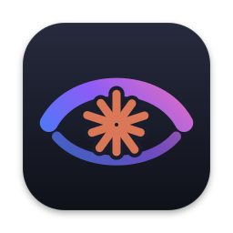

# Agent Watch (aw)

> **Universal macOS Desktop Control & Monitor for AI Agents**

Agent Watch lets you monitor and interact with autonomous AI agents (Claude Code, Aider, Antigravity, OpenHands, custom CLI scripts, and desktop tools) directly from your macOS Menu Bar.

Whenever an agent requires user approval (e.g. running a bash command, file modification) or input, Agent Watch surfaces an alert badge, triggers a native macOS notification, and allows you to **Approve, Reject, or enter text directly from the macOS Menu Bar** without having to hunt down the terminal window.

---

## Features

- **macOS Menu Bar Control**: Sits quietly in your menu bar. When any agent needs input, the icon pulses with an attention badge showing the exact number of agents waiting.
- **Answer Any Kind of Question**: Approve/Reject for `[y/N]` prompts, one-click option buttons for numbered, lettered, inline (`(Y)es/(N)o/(A)ll`, `[y/n/a/q]`) and arrow-key menus, masked entry for passwords and API keys, a Continue button for "Press Enter" prompts, and a text field for everything else.
- **Universal CLI Wrapper (`aw run`)**: Wrap any CLI command or agent without modifying a single line of code (`aw run claude`, `aw run aider`, `aw run agy`).
- **Real-Time Output Streaming**: View live rolling terminal snippets of active agents with clean ANSI color support.
- **Bidirectional Input**: Send input from either your physical terminal or the menu bar control seamlessly.
- **Model Context Protocol (MCP)**: Native MCP endpoint (`POST /mcp`) supporting `request_user_input` and `report_status` tools.
- **Jump to Terminal**: 1-click button to bring the agent's exact terminal window to the front.
- **Native macOS Notifications**: Actionable notifications via `UserNotifications` with inline Approve/Reject action buttons.

---

## Architecture

Agent Watch is built as two cooperating components:

1. **Rust Core (`crates/`)**:
   - `aw-daemon`: High-performance local HTTP & WebSocket daemon (`127.0.0.1:45123`), managing agent state, circular output buffers, and MCP endpoints.
   - `aw-cli` (`aw`): CLI tool providing universal PTY wrapper (`aw run`), status inspector (`aw list`), interactive prompt helper (`aw ask`), and manual input injector (`aw input`).
   - `aw-core`: Prompt detection heuristics and regex pattern matching engine.

2. **Native macOS App (`macOS/AgentWatch`)**:
   - Written in Swift 6.4 and SwiftUI using `MenuBarExtra` and `UNUserNotificationCenter`.
   - Real-time bidirectional WebSocket client for instant state sync with 0% idle CPU and minimal memory footprint (<25 MB).

---

## Getting Started

### 1. Build and Package

Run the packaging script to build the release binaries and the `.app` bundle:

```bash
./scripts/package_app.sh
```

This generates:
- `dist/AgentWatch.app` (macOS Menu Bar app)
- `target/release/aw` (CLI binary)

### 2. Install

Run the automated install script to copy `AgentWatch.app` to `/Applications`, symlink `aw` to `~/.local/bin/aw`, and set up the LaunchAgent service so Agent Watch starts automatically at login:

```bash
./scripts/install.sh
```

The installer handles:
- Stopping any older running instances cleanly (avoiding macOS binary caching issues)
- Copying `AgentWatch.app` to `/Applications/AgentWatch.app`
- Creating the symlink `~/.local/bin/aw -> /Applications/AgentWatch.app/Contents/MacOS/aw`
- Installing `com.agentwatch.app.plist` to `~/Library/LaunchAgents/` and loading it with `launchctl`
- Launching Agent Watch immediately in your macOS Menu Bar

If `~/.local/bin` isn't on your PATH, add `export PATH="$HOME/.local/bin:$PATH"` to your `~/.zshrc` or `~/.bashrc`.

> **Note on manual installation**: If copying manually, always delete `/Applications/AgentWatch.app` before copying a new build over it to avoid macOS code-signature caching errors (`exit code 137`).

### 3. Launch Agent Watch

Open `AgentWatch.app` from Spotlight, Applications, or terminal:

```bash
open /Applications/AgentWatch.app
```

The Agent Watch icon will appear in your macOS Menu Bar.

---

## Usage

### Running Terminal Agents

Simply prepend `aw run` to any command:

```bash
# Monitor Claude Code
aw run claude

# Monitor Aider
aw run aider

# Monitor Antigravity
aw run agy

# Monitor custom scripts
aw run python3 scripts/mock_agent.py
```

### Shell Aliases (Recommended)

Add these aliases to your `~/.zshrc` or `~/.bashrc` to monitor agents automatically:

```bash
alias claude="aw run claude"
alias aider="aw run aider"
alias agy="aw run agy"
```

### CLI Commands

- `aw daemon`: Starts the background state daemon manually (auto-started by the macOS app if needed).
- `aw list`: Lists all running and recent agent sessions with their status and prompts.
- `aw ask "Prompt question"`: Prompts the user on the macOS menu bar and prints their response (great for shell scripts!).
  - `aw ask "Deploy where?" -o staging -o production` shows option buttons and prints the chosen one.
  - `aw ask "Pick a model" -o "Fast=haiku" -o "Smart=opus"` shows the label, prints the value after `=`.
  - `aw ask "GitHub token" -t secret` asks with a masked field. Types: `confirm`, `select`, `text`, `secret`, `acknowledge`.
- `aw input <session_id> <text>`: Injects text into a running agent session.

---

## MCP (Model Context Protocol) Support

Agent Watch exposes a local MCP server endpoint at `http://127.0.0.1:45123/mcp`. You can configure your MCP client (Claude Desktop, Cursor, etc.) to use Agent Watch:

```json
{
  "mcpServers": {
    "agent-watch": {
      "url": "http://127.0.0.1:45123/mcp"
    }
  }
}
```

Available MCP tools:
- `request_user_input(prompt, prompt_type?, options?, choices?)`: Asks the user in the macOS menu bar and suspends until they answer. `options` is a list of strings shown as buttons; `choices` is a list of `{label, value}` when the returned value should differ from the label. `prompt_type` is one of `confirm`, `select`, `text`, `secret`, `acknowledge` (default: `select` when choices are given, otherwise `confirm`).
- `report_status(message, session_name)`: Updates the status description shown in the menu bar popover.

---

## Testing

Simulate an interactive agent asking for approval:

```bash
aw run python3 scripts/mock_agent.py
```

Look up at your macOS Menu Bar:
1. The Agent Watch icon will display a badge `1`.
2. A native notification banner will appear.
3. Click the menu bar icon to view the prompt and click **[Approve (y)]** or **[Reject (n)]**.
4. The agent instantly receives your choice and completes!

Simulate a multiple-choice question, a secret and a "Press Enter" prompt:

```bash
aw run python3 scripts/mock_menu_agent.py
```
